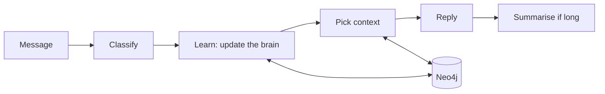
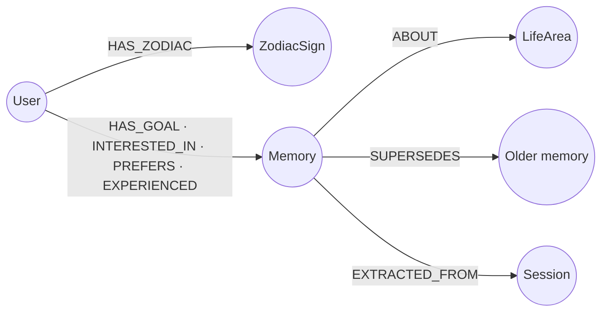

# MyNaksh Shared Brain

A personalised astrology chat service. It remembers what users tell it in a graph (the **Shared Brain**), picks only the
memories each question needs, and keeps short-term chat context separate from long-term facts.

**Stack:** Python 3.11 · FastAPI · LangGraph · Neo4j · LiteLLM · Pydantic

```bash
pip install -e ".[dev]" && pytest -q   # 42 tests, ~5 s, no API key or database needed
cp .env.example .env                   # add a provider key, e.g. OPENAI_API_KEY
docker compose up --build              # API on :8000, chat console on /ui, Neo4j browser on :7474
```

Then replay the example conversation with [`demo.http`](demo.http), or chat in the console at `localhost:8000/ui`.

## Requirements checklist

| Requirement | Where | Proved by |
|---|---|---|
| `POST /chat` with `context_used` | [`api/routes.py`](app/api/routes.py) | `test_health_and_chat_response_shape` |
| User profile and sun sign (stubbed) | `/users`, [`profile/zodiac.py`](app/profile/zodiac.py) | `test_create_long_term_memory_and_profile` |
| Shared Brain in a graph | Neo4j, [`brain/neo4j_repo.py`](app/brain/neo4j_repo.py) | `test_new_session_recalls_goal_from_brain` |
| Short-term vs long-term memory | LangGraph checkpointer vs Neo4j | `test_followup_uses_short_term_context_only` |
| Don't store every message | Extract → score → filter | `test_hypothetical_is_not_stored` |
| Context selection | [`nodes/analyze.py`](app/graphs/nodes/analyze.py), [`context/builder.py`](app/context/builder.py) | `test_irrelevant_memory_not_in_career_context` |
| Swappable LLM provider | [`llm/provider.py`](app/llm/provider.py) protocol, LiteLLM behind it | provider and model are config only |
| Memory update and corrections | [`graphs/memory_graph.py`](app/graphs/memory_graph.py) | `test_correction_supersedes_old_memory` |
| Error handling | a `degraded` flag instead of a failed request | `test_brain_down_degrades_gracefully`, `test_llm_down_…` |
| 5–10 scenarios, tests, eval plan | [`tests/`](tests), [`eval/`](eval), [TESTING](docs/TESTING.md) | 42 tests, 10 scenario journeys |
| Bonus (7 of 8) | confidence, conflicts, decay, summaries, fallback, token budgets, Hindi | advanced graph traversal skipped |

## How a turn works



1. **Load** the user's profile and a one-line-per-topic summary of what the brain holds.
2. **Classify** the message with a small model: is it a question, a follow-up, a question about what is stored,
   a remember/forget command, or small talk? Which life areas does it touch, and what language is it in?
3. **Learn** before replying: pull out durable facts, score them with rules, drop the ones not worth keeping,
   and add, update or replace memories in the graph.
4. **Pick context**: only the memories for the life areas the message is about, within fixed token budgets.
5. **Reply** with the stronger model. It may look up more memories, at most twice, and its tools are read-only.
6. **Summarise** older turns once the chat gets long, so the prompt stays small.

## Shared Brain



- **Entities:** `User` (birth details live here), `Memory` (a goal, preference, interest or life event), `LifeArea`
  (career, relationships, health, finance, family, education, spirituality, general), `Session`, `ZodiacSign`.
- **Relationships:** typed edges from user to memory. `SUPERSEDES` keeps the history of a corrected fact, and
  `EXTRACTED_FROM` records which chat each memory came from.
- **Retrieval:** follow `ABOUT` edges to the asked-about life areas (always including `general`), then rank by
  importance × confidence × recency.

## Memory policy

- **Stored:** goals, lasting preferences and interests, important life events, birth details.
- **Never stored:** questions, small talk, moods, hypotheticals, facts about other people, anything the assistant
  said, and health diagnoses or financial figures.
- **Dates are resolved when stored:** "next year" becomes `2027`, and "next month" sets an expiry date.
- **Corrections replace, they don't pile up.** The old memory is marked superseded and linked to the new one.
- **Confidence comes from rules, not the model.** The model only labels each fact; rules turn the labels into a score:

| The user said it… | Confidence | Stored? |
|---|---|---|
| And asked us to remember it | 1.0 | yes |
| As a fact or firm plan ("I'm switching jobs") | 0.9 | yes |
| Hedged ("I might switch") | 0.6 | only just (threshold is 0.6) |
| Hypothetically ("if I ever…") | 0.3 | no |
| About someone else | × 0.5 | no |

Repeating a fact raises its confidence. Memories that aren't used fade slowly; birth details never fade.

## Context selection

Each prompt is built from fixed-size parts, never the whole graph or the whole chat:

| Part | Contents | Included |
|---|---|---|
| Profile | Name, birth details, sun sign, and which birth details are still missing | always |
| Memory summary | One line per life area ("career: 2 goals"), so the model knows what exists | always |
| Relevant memories | Top 5 memories for the life areas in the question | questions and recall |
| Recent chat | The last few messages | always |
| Older-chat summary | A running summary once the chat is long | when present |

Every reply returns `context_used` and `context_tokens`, so you can see exactly what reached the model.

## Key decisions

1. **Learn before replying.** The reply can't contradict what was just stored. *Cost: about 1.4 s per turn.*
2. **Neo4j, not a vector store.** History and provenance are edges. *Cost: no fuzzy matching on wording.*
3. **Rules produce the scores.** Reproducible and testable. *Cost: the weights are hand-set, so a labelled set
   checks them.*
4. **No keyword rules for meaning.** Routing, and which memory a "forget" means, are model decisions; code only
   enforces limits. *Cost: one extra small-model call per turn.*
5. **Bad birth details are refused, not guessed.** A wrong chart is worse than none. *Cost: the user is asked again.*

The reasoning and the alternatives are in [DECISIONS](docs/DECISIONS.md).

## Tests and results

```bash
pytest -q                        # 42 tests, scripted LLM, in-memory brain
python -m eval.run_eval          # memory accuracy on 30 labelled messages (needs an API key)
python -m eval.run_scenarios     # 10 multi-turn journeys against a running API
```

| Check (gpt-4o-mini, Neo4j) | Result |
|---|---|
| Unit and integration tests | 42/42 pass |
| Store / don't-store decision (30 messages) | precision 100%, recall 100% at threshold 0.6; recall falls to 87% at 0.7 |
| Fact labels: certainty / subject / type | 100% / 100% / 93% |
| Scenario journeys (68 checks) | 6 pass, 4 known issues, 0 regressions — [report](eval/results/scenarios.md) |

## Known limitations and next steps

- **Latency:** learning in the turn adds about 1.4 s. Running extraction alongside the reply would recover most of it.
- **Concurrency:** two messages from the same user at once can race. A per-user lock would fix this.
- **No auth:** any caller can read any `user_id`. Production needs authentication.
- **Exact matching only:** retrieval narrows by life area, with no semantic re-ranking inside an area yet.
- **Open scenario issues:** a hedged retraction is dropped; the same plan can be stored under two names; small talk
  can deny stored memories; a diagnosis said earlier in the chat can be repeated back from the transcript.
- **Not yet verified:** the Postgres checkpointer option. Eval numbers are single runs of one model.

## Production considerations

- **Privacy:** birth data is personal data. Sensitive categories are never stored, deletes are soft and visible,
  and `DELETE /users/{id}/memories/{memory_id}` supports right-to-forget.
- **Isolation:** every query is scoped by `user_id`, and IDs are pattern-checked so one user can't reach another's chat.
- **State:** a Postgres checkpointer with a TTL for chats; a nightly job to archive expired memories.
- **Observability:** per-node traces (Langfuse or LangSmith), plus route mix, writes per turn and the degraded rate.
- **Charts:** geocode `birth_place` instead of only checking its shape; a real chart needs coordinates.
- **Cost:** the small model handles classification and memory work, prompts stay within fixed budgets, and the tool
  loop is capped.

Configuration is all environment variables: see [`.env.example`](.env.example) and [`app/config.py`](app/config.py).

## More

[ARCHITECTURE](docs/ARCHITECTURE.md) — design detail · [DECISIONS](docs/DECISIONS.md) — trade-offs and lessons ·
[TESTING](docs/TESTING.md) — scenarios and evaluation · [API](docs/API.md) — sample requests and responses
