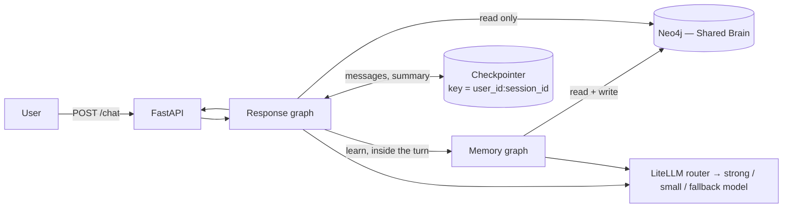
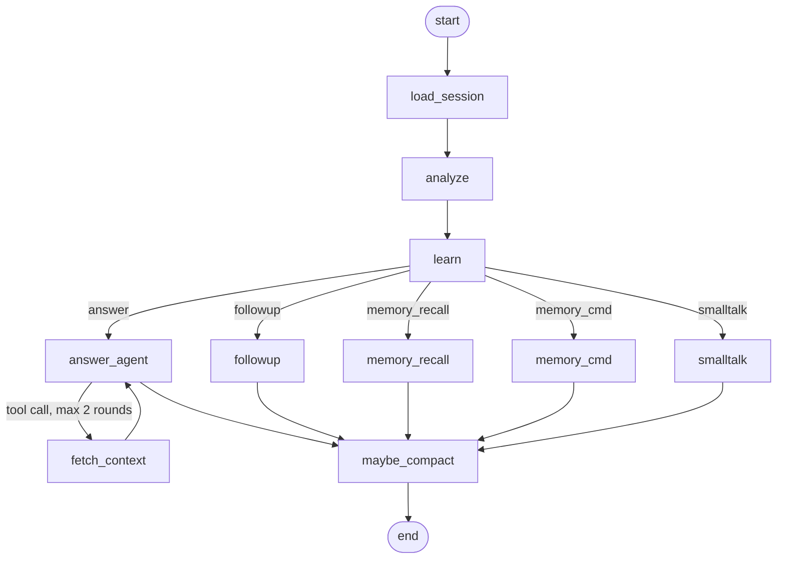
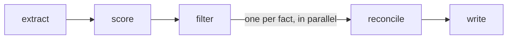

# Architecture

Design detail behind the [README](../README.md). Read the README first: this page doesn't repeat it.

## Components



| Part | Owns |
|---|---|
| Response graph | One chat turn: classify, learn, build context, reply, summarise |
| Memory graph | Turning a message into memories: extract, score, filter, reconcile, write |
| Checkpointer | The current chat (short-term). In memory for tests, Postgres in production |
| Neo4j | Everything that outlives a chat (long-term) |
| LiteLLM router | Which model each task uses, retries, provider fallback |

Every external dependency sits behind a protocol (`BrainRepository`, `LLMProvider`) with an in-memory twin, which is
why the test suite needs no keys or database.

## Response graph



| Node | What it does |
|---|---|
| `load_session` | Loads the profile and memory summary. If Neo4j is down it flags `brain_unavailable` and carries on |
| `analyze` | One small-model call: route, life areas, reply language |
| `learn` | Runs the memory graph for questions, follow-ups and recall, so the reply sees what was just stored |
| `answer_agent` | Fetches the top memories for the life areas, then calls the strong model with read-only tools |
| `fetch_context` | Runs the tool calls the model asked for (`recall_memories`, `get_astro_profile`, `search_past_sessions`) |
| `followup` | Answers "why?" from the recent chat only: no retrieval |
| `memory_recall` | Facts come straight from the graph; the model only words them, so it can't invent one |
| `memory_cmd` | Remember or forget, applied in the same turn and confirmed |
| `smalltalk` | Profile only, no memories |
| `maybe_compact` | Once the chat passes its budget, folds older turns into a running summary |

Two checks in `analyze` stay in code because neither is a judgement about meaning: a follow-up needs a previous reply
to exist, and a message with no Devanagari characters is never labelled as Devanagari Hindi.

## Memory graph



| Step | How |
|---|---|
| Extract | Small model. Uses only the user's words; the previous reply is shown only to resolve "this year, not next". Values are stored in English, dates as absolute dates |
| Score | Rules turn the model's labels into confidence and importance (table in the README) |
| Filter | Drops anything below 0.6, never-store categories, and facts about other people |
| Reconcile | Compares each fact with existing memories and chooses add, update, replace or ignore |
| Write | Idempotent `MERGE`, plus `SUPERSEDES` and `EXTRACTED_FROM` edges |

Skipped for small talk, memory commands (which write directly) and temporary chats (`ephemeral: true`).

**What the model labels per fact:** `type` (goal, preference, interest, life_event, profile_fact), `key` (a reusable
slot such as `career_change`), `value`, `attributes` (e.g. `target_year`), `life_area`, `certainty` (explicit, hedged,
hypothetical), `subject` (self or other), `valid_until`, and `sensitive_category`. It never outputs a number.

**Birth details** (`name`, `dob`, `tob`, `birth_place`, `preferred_language`) are written to the `User` node, never as
memories. The slot name decides this, not the type the model guessed. Every write path goes through one validator
that rejects impossible values rather than repairing them, and the reply is told what was rejected so it can ask again.

## Conflicts and corrections

| Kind of slot | Examples | A new value… |
|---|---|---|
| Single-valued | birth date, birth place, current job | always replaces the old one |
| Multi-valued | goals, interests, preferences | the model decides: add, update, replace or ignore |

- A correction often uses a *different* key ("start a business instead of switching jobs"), so reconcile also sees up
  to five recent goals and life events in the same life area.
- A firmer statement beats a hedged one, and a later statement beats an earlier one.
- Nothing is deleted. A replaced memory becomes `superseded`, linked from its replacement.

## Forgetting

Forgetting is the one operation that destroys data, so meaning and limits are split:

| Question | Decided by |
|---|---|
| Is this an instruction about memory? | the classifier |
| Which stored memories does it mean? | the model, shown each memory with its ID |
| Which memories may be touched? | code: only IDs it was shown; "forget everything" is a separate flag |

A forget that names nothing ("forget that") deletes nothing and asks which memory is meant. Deletes are soft
(`status: deleted`), so a mistake can be undone.

## Retrieval, expiry and decay

```
score = importance × confidence × e^(−λ × days since last used)
```

| Memory type | λ per day | Half-life |
|---|---|---|
| Birth details and profile facts | 0 | never fades |
| Goal, life event | 0.005 | about 4.5 months |
| Preference | 0.01 | about 10 weeks |
| Interest | 0.02 | about 5 weeks |

Memories past their `valid_until` date are excluded. Decay is computed when memories are read, so no scheduler is
needed. Using a memory in a reply resets its clock, except on the turn that created it.

## Shared Brain schema

```
(:User {user_id, name, dob, tob, birth_place, preferred_language, zodiac, created_at, updated_at})
(:Memory {id, type, key, value, attributes, life_area, cardinality, certainty, source,
          confidence, importance, mention_count, last_used_at, last_confirmed_at,
          valid_until, status, prompt_version, created_at, updated_at})
(:LifeArea {name})   (:Session {key, user_id, session_id, summary, turn_count})   (:ZodiacSign {name})

(User)-[:HAS_GOAL | INTERESTED_IN | PREFERS | EXPERIENCED | HAS_FACT]->(Memory)
(Memory)-[:ABOUT]->(LifeArea)          (Memory)-[:SUPERSEDES]->(Memory)
(Memory)-[:EXTRACTED_FROM]->(Session)  (User)-[:HAD_SESSION]->(Session)
(User)-[:HAS_ZODIAC]->(ZodiacSign)     (User)-[:PREFERS_LANGUAGE]->(Language)
```

Unique constraints on `User.user_id`, `Memory.id` and `Session.key`, with an index on `(Memory.life_area, status)`.
Session keys combine user and session, so a session ID alone can never reach another user's chat.

## Models and languages

| Task | Model | Temperature |
|---|---|---|
| Classify, extract, reconcile, choose forget targets, summarise | small | 0 (decisions must repeat) |
| Small talk | small | 0.4 |
| Answer, follow-up, recall | strong | 0.4 |

- **Failure path:** retry, then the fallback provider, then a canned reply flagged `llm_unavailable`.
- **Bad JSON:** structured output is retried once with the validation error, then skipped.
- **Languages:** the reply language is an explicit request if there is one, otherwise the language of the message,
  otherwise the profile preference. Prompts and stored memories are English only, so a fact said in Hinglish can
  answer an English question.

## Error handling

| Failure | Behaviour |
|---|---|
| Malformed request | 422 with field errors |
| Impossible birth detail | Not stored; the reply says which part it couldn't use |
| Missing profile | General answer that asks only for the missing details |
| LLM down | Fallback model, then canned reply, `degraded: ["llm_unavailable"]` |
| Neo4j down | Reply from the current chat only, `degraded: ["brain_unavailable"]`, no writes |
| Extraction fails | No write this turn; the reply still goes out |
| No relevant memories | Reply without them; `context_used` shows only what was used |
| Tool loop | Capped at 2 rounds, plus a graph recursion limit |

## Code layout

```
app/
├── api/            routes and request/response schemas
├── graphs/         response_graph.py, memory_graph.py, state.py, nodes/ (one file per node)
├── brain/          models, scoring, repository protocol, Neo4j and in-memory versions, profile validation
├── context/        prompt assembly and token budgets
├── llm/            provider protocol, LiteLLM router
├── prompts/        all prompts, versioned (the version is stored on every memory)
├── tools/          read-only tools for the answering agent
├── profile/        sun-sign stub
└── static/         the console at /ui
tests/  ·  eval/  ·  docs/  ·  demo.http  ·  docker-compose.yml
```

The console at `/ui` shows each turn's route, the context parts with their token counts, any tool calls, and what the
memory graph extracted, dropped and wrote.
