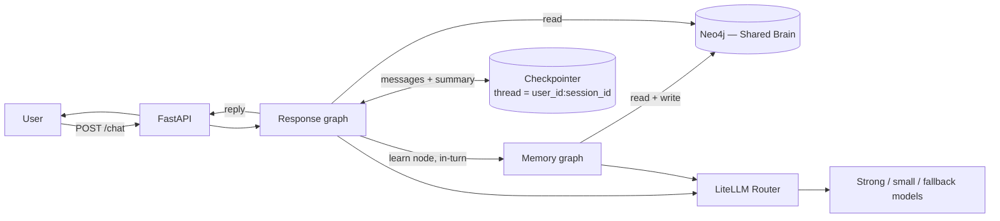
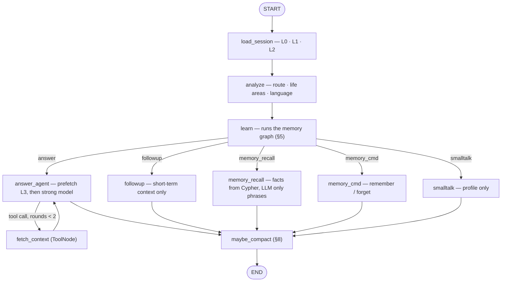
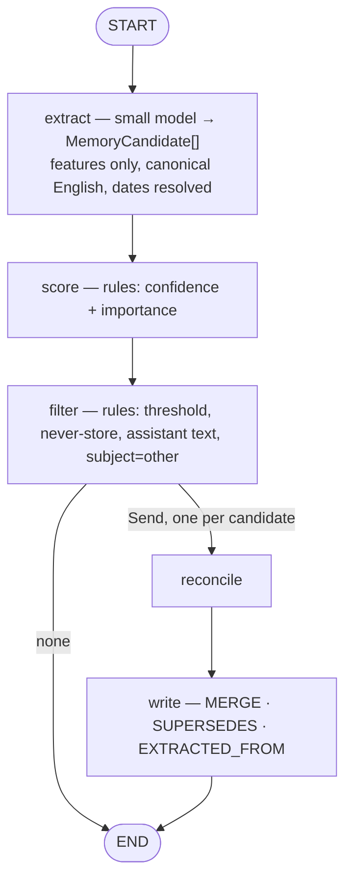
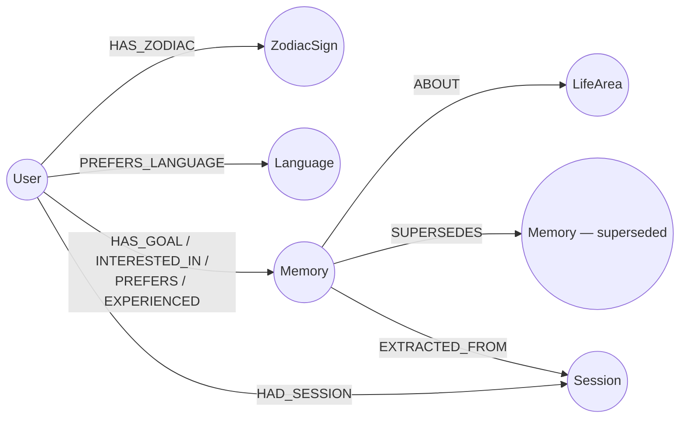

# MyNaksh Shared Brain — Architecture

Personalised astrology chat: short-term session context, a persistent graph **Shared Brain**, and LLM replies.

**Stack:** Python · FastAPI · LangGraph · Neo4j · LiteLLM · Pydantic

Companion docs: [DECISIONS](DECISIONS.md) (why, and what it cost) · [API](API.md) (sample requests) ·
[TESTING](TESTING.md) (scenarios + evaluation).

---

## 1. Principles

1. **Agentic where judgment is needed, deterministic where reliability is needed.** The LLM classifies and phrases;
   rules score, filter and write.
2. **One verdict per turn.** The memory write happens *inside* the turn, before the reply is composed, so the reply
   and the store can never disagree about the sentence the user just sent.
3. **Two memories, two owners.** The LangGraph checkpointer owns the session (messages, summary). Neo4j owns durable
   user facts.
4. **Curated facts, not raw logs.** Only what the user stated about themselves, filtered and scored. Never the
   assistant's own claims.
5. **Bounded context.** Every prompt layer has a token budget, so prompt size stays flat as the graph grows.
6. **Degrade, don't crash.** Every external dependency has a fallback, and degradation is reported in the response.

---

## 2. System overview



| Component | Responsibility |
|---|---|
| **FastAPI** | Validation, endpoints, dependency container |
| **Response graph** | Classify → learn → build bounded context → reply → compact |
| **Memory graph** | Extract → score → filter → reconcile → write |
| **Checkpointer** | Short-term state per session (`InMemorySaver` in tests, Postgres in production) |
| **Neo4j** | Shared Brain: profile, memories, sessions, life areas |
| **LiteLLM Router** | Per-task model choice, retries, provider fallback |

---

## 3. Context selection

Each turn's prompt is assembled from layers, each with a fixed token budget. Nothing else is sent — never the whole
graph, never the whole transcript.

| Layer | Content | When | Budget |
|---|---|---|---|
| **L0 meta** | Date, timezone, reply language | always | — (fixed) |
| **L1 profile** | Name, DOB, TOB, birth place, sun sign, language — plus *which* of them are missing | always | 150 |
| **L1b refused** | Values this message offered that the store rejected (§11) | when non-empty | 150 |
| **L2 index** | One line per life area: `career: 2 goals · finance: 1 goal` | always | 100 |
| **L3 memories** | Top-k memories for the classified life areas | `answer` / `memory_recall` | 600 |
| **ST summary** | Compacted summary of older turns | if present | 300 |
| **ST turns** | Last K messages verbatim | always | 1200 |

- **L2 is the cheap hedge:** the model knows what exists even when it isn't loaded, so it never claims to know nothing.
- **L1 names the gaps** rather than leaving the model to diff six `unknown` rows — re-asking for a detail already on
  file is what makes a brain feel like it forgot.
- Stable layers come first so provider prefix caching applies; volatile L0 goes last.
- Per-layer token counts are returned on every reply as `context_tokens`.

---

## 4. Response graph (synchronous)



**`load_session`** — loads L0/L1/L2 and resets per-turn state. Neo4j down → `degraded: ["brain_unavailable"]`,
continue on short-term context.

**`analyze`** — one small-model call per turn returning route, life areas and reply language. There is no keyword
fast path: the word lists that used to catch greetings, follow-ups and recall questions were the same instrument
that read "Remove obstacles from my career, what should I do?" as a deletion (§7.6), so the rules they encoded now
live in `ANALYZE_SYSTEM` where something can weigh them against the sentence.

Two checks stay in code because neither is a judgement about meaning: a `followup` answers from a previous reply, so
it needs one to exist; and a message containing no Devanagari is not written in Devanagari, whatever the model
labelled it — the model mislabels romanised Hindi roughly one time in four, and the cost is answering someone in a
script they may not read.

**`learn`** — the memory graph, in-turn, before any reply node. See §5.

**`answer_agent`** — deterministic prefetch of top-k memories for the classified life areas, then the strong model,
then at most 2 rounds of **read-only** tool calls. The agent cannot write long-term memory.

| Tool | Returns |
|---|---|
| `recall_memories(life_area, query)` | Active memories for a life area |
| `get_astro_profile()` | Sun sign and stubbed chart attributes |
| `search_past_sessions(query)` | Summaries of earlier sessions |

**`fetch_context`** — a LangGraph `ToolNode`. The model can only *request* a call; this node executes it, so
reasoning and execution are traced separately and the round cap lives on the edge between them.

**`followup`** — recent turns and summary only. No retrieval.
**`memory_recall`** — facts come from Cypher; the LLM only phrases them, so they cannot be hallucinated.
**`memory_cmd`** — explicit remember/forget, applied in the same turn, then confirmed. Which memories a forget
refers to is decided by the model from the memories themselves, inside the bound in §7.6.
**`smalltalk`** — profile card only.

Memories actually used in a reply get `last_used_at` refreshed (§7.4) — except ones this same turn created.

---

## 5. Memory graph (in-turn, before the reply)



Runs for `answer` / `followup` / `memory_recall`. Skipped for `smalltalk`, `memory_cmd` (writes inline) and
`ephemeral: true`.

**Why before the reply, not after.** It used to run as a `BackgroundTask` once the reply had been sent. Two defects
followed from that, and they are the same defect: the store refused `"65 may 2200"` and the reply — which never saw
the refusal — restated it as fact; and a user who typed again within ~2 s got a turn whose profile had not caught up.
Learning first gives one verdict. The write is durable before the response leaves, the reply speaks from the
refreshed profile, and anything refused is named in the prompt (L1b) so the reply can say *which part* it could not
use. Cost: ~1.4 s per turn.

**`extract`** — the user's message only; the previous assistant turn is passed as reference-only, so "actually this
year, not next" resolves, but assistant text is never a source of facts. Relative dates resolve against L0.
Values are normalised to canonical English, so a fact stated in Hindi answers an English question.

**`score` / `filter`** — deterministic (§7.2). Drops confidence < 0.6, never-store categories, hypotheticals.

**`reconcile`** — one parallel run per candidate via `Send` (§7.5). **`write`** — idempotent `MERGE` on a canonical key.

---

## 6. Shared Brain schema (Neo4j)



```
(:User {user_id, name, dob, tob, birth_place, created_at, updated_at})
(:ZodiacSign {name})                    // derived from dob
(:Language {code})                      // en | hi | hinglish
(:LifeArea {name})                      // career, relationships, health, finance, family,
                                        // education, spirituality, general
(:Session {key, user_id, session_id, summary, turn_count, started_at, ended_at})
(:Memory {
    id, type, key, value, attributes,   // attributes JSON, e.g. {"target_year": 2027}
    life_area, cardinality,             // single | multi
    certainty, source, confidence, importance,
    mention_count, last_used_at, last_confirmed_at,
    valid_until, status,                // active | superseded | expired | deleted
    prompt_version, created_at, updated_at
})
```

| Relationship | Meaning |
|---|---|
| `HAS_ZODIAC`, `PREFERS_LANGUAGE` | Profile-derived attributes |
| `HAS_GOAL`, `INTERESTED_IN`, `PREFERS`, `EXPERIENCED` | User → Memory, typed by memory type |
| `ABOUT` | Memory → LifeArea — the main retrieval axis |
| `SUPERSEDES` | Replacement → replaced memory (history, never deleted) |
| `EXTRACTED_FROM` | Memory → Session (provenance) |
| `HAD_SESSION` | User → Session |

```cypher
CREATE CONSTRAINT user_id      FOR (u:User)    REQUIRE u.user_id IS UNIQUE;
CREATE CONSTRAINT memory_id    FOR (m:Memory)  REQUIRE m.id IS UNIQUE;
CREATE CONSTRAINT session_key  FOR (s:Session) REQUIRE s.key IS UNIQUE;   -- key = user_id:session_id
CREATE INDEX memory_lookup     FOR (m:Memory)  ON (m.life_area, m.status);
CREATE INDEX session_lookup    FOR (s:Session) ON (s.user_id, s.session_id);
```

**Why a graph:** memories are relational (user → goal → life area → session); supersession history and provenance
are edges rather than extra tables; retrieval is a traversal by life area, not a scan.

---

## 7. Memory strategy

### 7.1 What the LLM extracts

| Field | Values |
|---|---|
| `type` | `goal` · `preference` · `interest` · `life_event` · `profile_fact` |
| `key` / `value` | canonical slot and canonical **English** value, e.g. `career_change` / `switch jobs` |
| `attributes` | e.g. `{"target_year": 2027}` |
| `life_area` | career, relationships, health, finance, family, education, spirituality, general |
| `certainty` | `explicit` · `hedged` · `hypothetical` |
| `subject` | `self` · `other` |
| `temporality` | `current` · `future` · `past` |
| `user_asked_to_remember` | bool |
| `valid_until` | date, for time-bound facts |

**Remember:** goals, stable preferences, interests, profile facts, significant life events.
**Don't:** small talk, questions, passing moods, hypotheticals, facts about other people, anything the assistant
said, never-store categories (health diagnoses, financial detail, third-party sensitive info — defined by substance
in the prompt, not by a term list).

The five profile slots (`name`, `dob`, `tob`, `birth_place`, `preferred_language`) are written to the `User` node, not
as `Memory` nodes — decided by the **key**, never by the type the extractor guessed.

### 7.2 Confidence and importance — rules, not the LLM

Verbalised LLM scores are poorly calibrated and unstable between runs, so the model labels features and rules produce
the numbers.

```python
BASE_CONFIDENCE = {"explicit": 0.9, "hedged": 0.6, "hypothetical": 0.3}   # ×0.5 if subject == "other"
                                                                          # 1.0 if user_asked_to_remember
BASE_IMPORTANCE = {"profile_fact": 1.0, "goal": 0.9, "life_event": 0.8,
                   "preference": 0.6, "interest": 0.5}
```

| Event | Effect |
|---|---|
| Mentioned again | `confidence += 0.1` (cap 1.0), `mention_count += 1` |
| User confirms | `confidence = 1.0`, `last_confirmed_at = now` |
| User contradicts | Old memory superseded (§7.5) |
| Used in a reply | `last_used_at = now` |

The 0.6 storage threshold is validated against a labelled set rather than asserted — see [TESTING](TESTING.md).

### 7.3 Retrieval score

```
score = importance × confidence × exp(-λ_type × days_since(last_used_at or updated_at))
```

Top-k active, non-expired memories for the relevant life areas, descending. A narrowed read always also includes the
`general` bucket — that is where extraction files anything it could not place, so matching the area exactly would turn
every misfiling into permanent amnesia.

### 7.4 Expiry and decay

**Hard:** `valid_until` excludes a memory from retrieval once past.
**Soft:** decay computed at read time, so no scheduler is needed.

| Type | λ/day |
|---|---|
| `profile_fact` | 0 — never decays |
| `goal`, `life_event` | 0.005 |
| `preference` | 0.01 |
| `interest` | 0.02 |

Using a memory resets `last_used_at`, so what keeps proving useful stays strong.

### 7.5 Conflict resolution

| Cardinality | Examples | On a new value for the same key |
|---|---|---|
| **single** | DOB, birth place, language, current job | deterministic **SUPERSEDE** |
| **multi** | goals, interests, preferences | LLM picks ADD / UPDATE / SUPERSEDE / NOOP |

- **Cross-key conflicts:** a correction often arrives under a *different* key — "start my own business **instead of**
  switching jobs" collides with nothing. So reconcile is also shown recent active `goal`/`life_event` memories in the
  same life area (capped at 5). Without this both goals stay active.
- **Source priority:** explicit correction > direct statement > earlier statement.
- **Never delete:** superseded memories keep `status: superseded` and a `SUPERSEDES` link from their replacement.
- A profile correction recomputes derived attributes (zodiac).

---

### 7.6 Deleting a memory

A forget is the one instruction that destroys, so it gets the strictest treatment of the three questions it raises:

| Question | Decided by | Why |
|---|---|---|
| Is this an instruction about memory at all? | the classifier | It is a question about meaning |
| Which stored memories does it refer to? | the model, from the listed memories | Also meaning |
| Which memories may be touched at all? | code | A bound, which is what code is for |

Both of the first two were once keyword rules, and both were wrong in the same way. The route came from a leading
verb, so *"Remove obstacles from my career, what should I do?"* read as an instruction about memory; the target was
then any memory sharing any word with the rest of the sentence, and `career` appeared in both. The reply was
*"Done — I've forgotten: switch jobs."* Four ordinary phrasings did this; one of them deleted the career memory the
user had just asked to hear about.

Word overlap is not reference. It cannot be made into reference by tightening the word list, because the thing being
asked — *which memory do you mean* — is semantic. So the model answers it, having been shown each memory with its id,
and the rules it is given are about caution: match on meaning rather than shared words, treat an uncertain match as
no match, and never return an id that was not in the list.

What code keeps is the part that is not a judgement:

- a forget may only touch ids that were in the list it was shown — an invented or borrowed id is dropped, never fetched
- `forget everything` is a separate flag, not a long list of ids
- an instruction that names no target at all ("forget that") deletes nothing and asks which memory is meant
- deletes stay soft (`status: deleted`), so a mistake is recoverable

This is the same division as everywhere else in the system — the model supplies meaning, the code supplies bounds —
but it is worth stating here because the first attempt got it backwards and tried to compute meaning in code.

---

## 8. Summarisation (`maybe_compact`)

Over the token threshold, older turns are summarised **incrementally** (previous summary + dropped turns → new
summary), the last K turns stay verbatim, the rest leave state via `RemoveMessage`, and the summary is persisted on
the `Session` node where `search_past_sessions` can find it.

Summaries are **episodic context, never facts**. Facts reach the brain only through the memory graph's filter.

---

## 9. Model routing

| Task | Tier |
|---|---|
| `analyze`, `extract`, `reconcile`, summarisation | small |
| `answer_agent`, `memory_recall`, `followup` | strong |

**Fallback:** primary (with timeout) → fallback provider → canned reply with `degraded: ["llm_unavailable"]`.
**Temperature is per task, not per model:** decisions run at 0.0 (otherwise the same correction sometimes `ADD`s and
sometimes `SUPERSEDE`s), replies at 0.4. Structured-output failures retry once with the validation error, then skip.
Every LLM node carries `RetryPolicy(max_attempts=2)`; the graph has a `recursion_limit`.

---

## 10. Multilingual

Reply language precedence: **explicit request** → **language of the message** → **profile preference**. Detection
happens in `analyze` as an LLM label (`en` / `hi` / `hinglish`).

Memories are stored in **canonical English** whatever the input language. Prompts are English-only — the reply
language is an instruction resolved against L0, not a translated prompt, so there is one prompt to maintain and no
drift between variants. Canned fallbacks are English too: they fire exactly when no model is reachable to translate.

---

## 11. Error handling

| Failure | Behaviour |
|---|---|
| Malformed request | Pydantic → 422 with field errors |
| **Unusable birth detail** | Refused, not repaired — see below |
| Unknown user / missing profile | Answer generically; ask only for the details actually missing |
| LLM failure | Retry → fallback provider → canned reply, `degraded: ["llm_unavailable"]` |
| Neo4j failure | Reply from short-term context, `degraded: ["brain_unavailable"]`; writes skipped |
| Extraction failure | Skip the write, log; never blocks the reply |
| No relevant memories | Proceed without L3; `context_used` lists only what was used |
| Agent loop runaway | 2 tool rounds + `recursion_limit` |

**Unusable birth details.** A chart is computed from `dob` / `tob` / `birth_place`, so a wrong value is worse than a
missing one: it yields a confident reading of a moment that never happened. Both write paths (the typed `/users` API
and the memory graph's PROFILE action) go through one choke point, `apply_profile_patch`, which **rejects rather than
repairs** — the prompt asks the model not to emit a repaired value, but a prompt is a request, not a guarantee.
A refusal is visible three ways: `SKIP` with a reason in the memory-run trace, the L1b prompt layer, and therefore the
reply itself, which names the part it could not make sense of instead of echoing it back as fact.

---

## 12. API

| Method | Endpoint | Purpose |
|---|---|---|
| `POST` | `/users` | Create a user (zodiac derived from DOB) |
| `GET` `PATCH` | `/users/{user_id}` | Read / update profile |
| `POST` | `/chat` | A chat turn |
| `GET` | `/users/{user_id}/memories` | Memories ranked by retrieval score |
| `DELETE` | `/users/{user_id}/memories/{memory_id}` | Forget (soft delete) |
| `GET` | `/users/{user_id}/memory-runs` | What the memory graph did, per turn |
| `GET` | `/health` | Liveness + brain/LLM status |
| `GET` | `/ui/` | Orchestration console |

Request/response examples: [API.md](API.md). `ephemeral: true` reads the brain and writes nothing.

---

## 13. Walkthrough

| # | Message | Route | Context used | Memory result |
|---|---|---|---|---|
| 1 | "My name is Rahul, born 15 Aug 1995 in Delhi. Planning to switch jobs next year." | `answer` | profile | PROFILE (sign = Leo); **ADD** `career_change {target_year: 2027}` |
| 2 | "What should I focus on for my career?" | `answer` | profile, career goal | nothing new |
| 3 | "Why do you say that?" | `followup` | recent turns | nothing |
| 4 | *new session:* "What do you remember about my career goals?" | `memory_recall` | career memories | nothing |
| 5 | "Actually I'll switch this year, not next." | `answer` | career goal | **SUPERSEDE** → `target_year: 2026` |
| 6 | "I have a PM interview next month." | `answer` | career goal | **ADD** with `valid_until` |
| 7 | "Meri shaadi kab hogi?" | `answer` | profile | reply in Hinglish; nothing stored |

Row 4 is the memory split made visible: the checkpointer is empty for the new `session_id`, the goal is still in Neo4j
under `user_id`. Replay it with [`demo.http`](../demo.http).

---

## 14. Project structure

One module per node under `app/graphs/nodes/`, one protocol per external dependency
(`BrainRepository`, `LLMProvider`) with an in-memory implementation beside the real one.
Full tree: [README](../README.md#project-layout).

---

## 15. Testing

42 tests, no network, keys or database required (scripted LLM + in-memory brain + `InMemorySaver`).
The eight required scenarios and what each proves: [TESTING.md](TESTING.md).

## 16. Evaluation

Memory accuracy ships as a script (`python -m eval.run_eval`); the rest are paired A/B runs with the brain on vs off.
Method and caveats: [TESTING.md](TESTING.md#evaluation).

---

## 17. Production considerations

- **Privacy:** birth data is PII — consent at signup, encryption at rest, never-store categories, a delete endpoint
  for right-to-forget.
- **Isolation:** every query scoped by `user_id`; ids are pattern-restricted so a crafted `session_id` cannot address
  another user's checkpointer thread.
- **Writes at scale:** the memory graph is in-turn today for read-after-write consistency. Moving it to a queue
  (Celery / Arq / SQS) buys back ~1.4 s but reintroduces the race, so it needs a per-user write lock or a
  read-your-writes cache — not just a queue.
- **Observability:** LangSmith / Langfuse traces per node; metrics for route distribution, memory writes per turn,
  degraded rate.
- **Checkpointer:** Postgres or Redis saver with a TTL on idle sessions.
- **Geocoding:** `birth_place` is validated for shape, not existence. A real chart needs lat/long, so production
  should geocode and reject what cannot be located.
- **Cost:** small model for classification and background work, prefix caching, bounded agent loop. Removing the
  keyword fast path costs one small-model call on turns that used to short-circuit; a cheap classifier or a cache
  keyed on the message would buy it back without putting word lists on the decision again.

---

## 18. Trade-offs

Short version; the reasoning is in [DECISIONS.md](DECISIONS.md).

| Decision | Alternative | Why |
|---|---|---|
| Two LangGraph graphs | One linear service | Branching, bounded tool loop, parallel reconcile, checkpointed session |
| Memory write in-turn | Background task | One verdict per turn; costs ~1.4 s |
| Neo4j | Vector store | Supersession, provenance and life-area traversal are relational |
| Rule-based scores | LLM-verbalised scores | Calibration and reproducibility |
| Life-area retrieval | Embedding search | Deterministic, explainable, testable |
| Read-time decay | Scheduled job | No infrastructure; add a job for archival |
| Read-only agent tools | Agent writes memory | Keeps unfiltered facts out of long-term memory |
