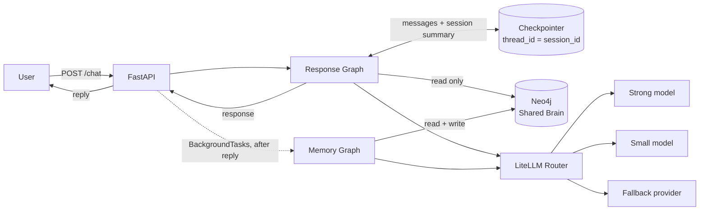
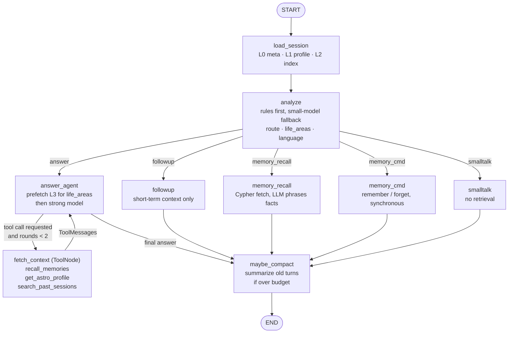
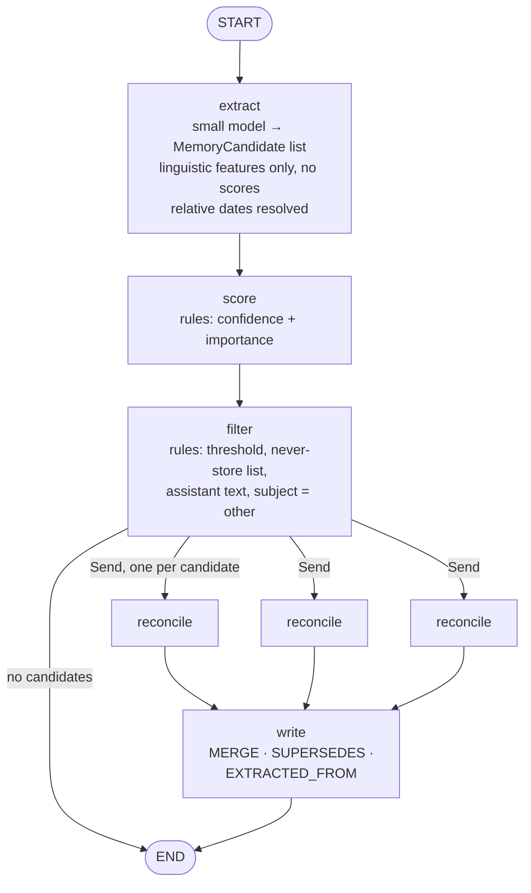
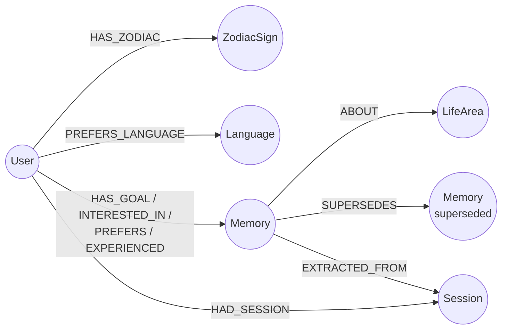

# MyNaksh Shared Brain — Architecture

Personalized astrology chat service with short-term context, a persistent graph-based Shared Brain, and LLM-driven responses.

**Stack:** Python · FastAPI · LangGraph · Neo4j · LiteLLM · Pydantic

---

## 1. Design principles

1. **Agentic where judgment is needed, deterministic where reliability is needed.** Routing shortcuts, safety filters, scoring and writes are rule-based. Context gathering and memory reconciliation get bounded LLM judgment.
2. **Separate read path from write path.** The response graph only *reads* the Shared Brain. Only the memory graph *writes* to it, after the user has their reply.
3. **Short-term and long-term memory have different owners.** The LangGraph checkpointer owns the session (messages, summary). Neo4j owns durable user facts.
4. **Curated facts, not raw logs.** Long-term memory stores what the user stated, filtered and scored, never every message and never the assistant's own claims.
5. **Bounded context.** Every prompt layer has a token budget, so prompt size stays flat as the graph and conversation grow.
6. **Degrade, don't crash.** Every external dependency (LLM, Neo4j) has a fallback, and degraded mode is reported in the response.

---

## 2. System overview



| Component | Responsibility |
|---|---|
| **FastAPI** | Validation, endpoints, schedules the memory graph as a background task |
| **Response graph** | Classifies the message, builds bounded context, generates the reply, compacts the session |
| **Memory graph** | Extracts, scores, filters, reconciles and writes long-term memories |
| **Checkpointer** | Short-term state per session. `MemorySaver` in tests, Redis/Postgres saver in production |
| **Neo4j** | Shared Brain: profile, memories, sessions, life areas |
| **LiteLLM Router** | Task-based model routing, retries, provider fallback |

---

## 3. Context layers

Each turn's prompt is assembled from layers, each with a fixed budget.

| Layer | Content | When included | Budget (tokens) |
|---|---|---|---|
| **L0 Session meta** | Current date, timezone, reply language | Always (never stored) | 30 |
| **L1 Profile card** | Name, DOB, birth place, sun sign, preferred language | Always | 150 |
| **L2 Memory index** | One line per life area: `career: 2 goals · finance: 1 goal` | Always | 100 |
| **L3 Detailed memories** | Top-k active memories for the relevant life areas | `answer` / `memory_recall` routes | 600 |
| **ST Session summary** | Compacted summary of older turns | Always (if present) | 300 |
| **ST Recent turns** | Last K messages verbatim | Always | 1200 |

- **L2** tells the model what exists even when it isn't loaded, so it never wrongly claims to know nothing.
- **Stable layers come first** (system prompt, L1) so provider prefix caching applies.
- Memories are serialized compactly, one line each: `- [career] Goal: switch jobs (target 2027, conf 0.9)`.
- Token counts per layer are returned in the API response (`context_tokens`).

---

## 4. Response graph (user-facing, synchronous)



### Nodes

**`load_session`**
- Loads L0, L1 and L2. The checkpointer has already restored this session's messages and summary.
- If Neo4j fails: sets `degraded += ["brain_unavailable"]` and continues with short-term context only.

**`analyze`**
- **Rules first:** short anaphoric messages ("why?", "explain that") → `followup`; "remember / forget" → `memory_cmd`; "what do you remember…" → `memory_recall`.
- **Small-model fallback** with structured output for everything else.
- Also outputs the **reply language** (`en` / `hi` / `hinglish`). An LLM is used for this because standard language detectors fail on romanized Hindi.

**`answer_agent`** — hybrid retrieval:
1. **Deterministic prefetch** of top-k memories for the classified life areas, ranked by retrieval score (§7.3).
2. Strong model generates the answer.
3. If the model requests more context, control passes to `fetch_context`. Capped at 2 rounds.
4. The agent has **read-only tools**. It cannot write long-term memory.

**`fetch_context`** (LangGraph `ToolNode`)
- The LLM can only *request* a tool call. This node executes it (runs the Cypher query) and appends the result as a `ToolMessage`.
- Kept as a separate node so reasoning and execution are traced, retried and tested separately, and so the round limit is enforced on the edge between them.

| Tool | Returns |
|---|---|
| `recall_memories(life_area, query)` | Active memories for a life area |
| `get_astro_profile()` | Sun sign and stubbed chart attributes |
| `search_past_sessions(query)` | Summaries of earlier sessions |

**`followup`** — answers from recent turns and the session summary only. No Neo4j calls, no memory write.

**`memory_recall`** — fetches memories for the requested area directly from Neo4j; the LLM only phrases them. Facts come from the graph, so they can't be hallucinated.

**`memory_cmd`** — explicit "remember X" / "forget X" is executed in the same turn (forget = mark `status: deleted` and remove from retrieval), then confirmed in the reply.

**`smalltalk`** — no retrieval; profile card only.

**`maybe_compact`** — see §8.

Every successful use of a memory updates its `last_used_at` (reinforcement, §7.4).

---

## 5. Memory graph (background, asynchronous)

Runs after the response is returned. Skipped entirely for `followup`, `smalltalk` and `ephemeral` requests.



**`extract`**
- Input: the user's message only. Assistant text is never a source of user facts.
- Output: list of `MemoryCandidate` (§7.1). The LLM labels observable features; it does not produce numeric scores.
- Relative dates are resolved against L0's current date: "next year" → `target_year: 2027`, "next month" → `valid_until: 2026-11-30`.
- Values are normalized to **canonical English** so memories stated in Hindi are retrievable by English questions and vice versa.

**`score`** — deterministic confidence and importance (§7.2).

**`filter`** — deterministic. Drops a candidate if:
- confidence < 0.6
- it falls in a never-store category (health details, finances, third-party sensitive info)
- `ephemeral` is set

**`reconcile`** — one parallel run per candidate via LangGraph's `Send` API (§7.5).

**`write`** — idempotent `MERGE` on a canonical key, `SUPERSEDES` links for replaced memories, `EXTRACTED_FROM` link to the session for provenance.

---

## 6. Shared Brain schema (Neo4j)



### Nodes

```
(:User {user_id, name, dob, tob, birth_place, created_at, updated_at})
(:ZodiacSign {name})                      // stub: derived from DOB
(:Language {code})                        // en, hi
(:LifeArea {name})                        // career, relationships, health, finance, family, education, spirituality
(:Session {session_id, started_at, ended_at, summary, turn_count})
(:Memory {
    id, type, key, value, attributes,     // attributes: JSON, e.g. {"target_year": 2027}
    life_area, cardinality,               // single | multi
    certainty, source,                    // explicit|hedged|hypothetical ; stated|confirmed
    confidence, importance,
    mention_count, last_used_at, last_confirmed_at,
    valid_until,                          // null = no hard expiry
    status,                               // active | superseded | expired | deleted
    created_at, updated_at
})
```

### Relationships

| Relationship | Meaning |
|---|---|
| `HAS_ZODIAC`, `PREFERS_LANGUAGE` | Profile-derived attributes |
| `HAS_GOAL`, `INTERESTED_IN`, `PREFERS`, `EXPERIENCED` | User → Memory, typed by memory type |
| `ABOUT` | Memory → LifeArea; the main retrieval axis |
| `SUPERSEDES` | New memory → memory it replaced (history, never deleted) |
| `EXTRACTED_FROM` | Memory → Session it came from (provenance) |
| `HAD_SESSION` | User → Session |

### Constraints and indexes

```cypher
CREATE CONSTRAINT user_id IF NOT EXISTS FOR (u:User) REQUIRE u.user_id IS UNIQUE;
CREATE CONSTRAINT memory_id IF NOT EXISTS FOR (m:Memory) REQUIRE m.id IS UNIQUE;
CREATE CONSTRAINT session_id IF NOT EXISTS FOR (s:Session) REQUIRE s.session_id IS UNIQUE;
CREATE INDEX memory_lookup IF NOT EXISTS FOR (m:Memory) ON (m.life_area, m.status);
```

### Why a graph
- Memories are naturally relational: user → goal → life area → session.
- Supersession history and provenance are edges, not extra tables.
- Retrieval is a traversal by life area, not a scan of everything the user said.

---

## 7. Memory strategy

### 7.1 What the LLM extracts

```python
class MemoryCandidate(BaseModel):
    type: Literal["goal", "preference", "interest", "life_event", "profile_fact"]
    key: str                      # canonical slot, e.g. "career_change", "preferred_language"
    value: str                    # canonical English
    attributes: dict = {}         # e.g. {"target_year": 2027}
    life_area: str
    certainty: Literal["explicit", "hedged", "hypothetical"]
    subject: Literal["self", "other"]
    temporality: Literal["current", "future", "past"]
    user_asked_to_remember: bool
    valid_until: date | None      # for time-bound facts
```

**Remember:** goals, stable preferences, interests, profile facts, significant life events — things likely to matter in a future conversation.

**Don't remember:** small talk, questions, passing moods, hypotheticals, facts about other people, anything the assistant said (including its own predictions), never-store categories.

### 7.2 Confidence and importance (rule-based)

LLM-verbalized confidence scores are poorly calibrated and unstable between runs, so the LLM only classifies features and rules produce the numbers.

```python
BASE_CONFIDENCE = {"explicit": 0.9, "hedged": 0.6, "hypothetical": 0.3}

def initial_confidence(c):
    if c.user_asked_to_remember:
        return 1.0
    score = BASE_CONFIDENCE[c.certainty]
    if c.subject == "other":
        score *= 0.5
    return score

BASE_IMPORTANCE = {"profile_fact": 1.0, "goal": 0.9, "life_event": 0.8,
                   "preference": 0.6, "interest": 0.5}
```

Confidence then evolves with **evidence across conversations**:

| Event | Effect |
|---|---|
| Same fact mentioned again | `confidence = min(1.0, confidence + 0.1)`, `mention_count += 1` |
| User confirms | `confidence = 1.0`, `last_confirmed_at = now` |
| User contradicts | Old memory superseded (§7.5) |
| Memory used in a reply | `last_used_at = now` (feeds decay) |

The 0.6 storage threshold is validated against a hand-labelled set (§11).

### 7.3 Retrieval score

```
retrieval_score = importance × confidence × recency_factor
recency_factor  = exp(-λ_type × days_since(last_used_at or updated_at))
```

Top-k active, non-expired memories for the relevant life areas are returned in descending score.

### 7.4 Expiry and decay

**Hard expiry** — time-bound facts carry `valid_until`. Past that date they are excluded from retrieval (or shown as a past event: "you had a PM interview in November").

**Soft decay** — computed at read time, so no scheduler is needed:

| Type | λ (per day) | Behaviour |
|---|---|---|
| `profile_fact` | 0 | Never decays |
| `goal`, `life_event` | 0.005 | Slow |
| `preference` | 0.01 | Moderate |
| `interest` | 0.02 | Fast unless reinforced |

Using a memory resets `last_used_at`, so memories that keep proving useful stay strong. Production: a nightly job marks memories `expired` once past `valid_until` or below a score floor.

### 7.5 Conflict resolution (`reconcile`)

Rules first, LLM only for multi-valued ambiguity.

| Cardinality | Examples | On a new value with the same `key` |
|---|---|---|
| **single** | DOB, birth place, preferred language, current job | Deterministic **SUPERSEDE** |
| **multi** | Goals, interests, preferences | LLM decides ADD / UPDATE / SUPERSEDE / NOOP against existing active memories |

| Decision | Example |
|---|---|
| **ADD** | No existing career goal |
| **UPDATE** | Goal exists; add `target_year` |
| **SUPERSEDE** | "Actually I'm switching this year, not next" |
| **NOOP** | Duplicate |

- **Source priority:** explicit correction > direct statement > earlier statement.
- **Never delete:** superseded memories keep `status: superseded` with a `SUPERSEDES` link from the replacement.
- Profile corrections (e.g. DOB) also recompute derived attributes such as the zodiac sign.

---

## 8. Conversation summarization (`maybe_compact`)

1. If the session's message tokens exceed the threshold, summarize the older turns **incrementally**: previous summary + turns being dropped → new summary.
2. Keep the last K turns verbatim; remove the rest from state with `RemoveMessage`.
3. Persist the summary on the `Session` node; `search_past_sessions` searches these.

Summaries are **episodic context**, never user facts. Facts reach the Shared Brain only through the memory graph's filter.

---

## 9. Model routing and fallback

LiteLLM Router, configured per task:

| Task | Model tier |
|---|---|
| `analyze` (fallback path), `extract`, `reconcile`, summarization | Small, cheap model |
| `answer_agent`, `memory_recall`, `followup` | Strong model |

**Fallback chain:** primary (with timeout) → fallback provider → canned reply with `degraded: ["llm_unavailable"]`.

**Structured output failures:** retry once with the validation error in the prompt, then skip — no memory write in the memory graph, default `answer` route in the response graph.

All LLM nodes carry a LangGraph `RetryPolicy(max_attempts=2)`; the graph has a `recursion_limit` to bound the agent loop.

---

## 10. Multilingual (Hindi / Hinglish)

**Reply language precedence:**
1. Explicit request in the message ("reply in Hindi"), which is also saved as the `PREFERS_LANGUAGE` preference.
2. Language of the current message.
3. Profile's preferred language.

- Language detection runs inside `analyze` (LLM label: `en` / `hi` / `hinglish`).
- **Memories are stored in canonical English** regardless of input language; responses are generated in the target language.

---

## 11. Error handling

| Failure | Behaviour |
|---|---|
| Invalid input | Pydantic validation → 422 with field errors |
| Unknown user / missing profile | Answer generically; prompt to share birth details when the question needs them |
| LLM failure | Retry → fallback provider → canned reply, `degraded: ["llm_unavailable"]` |
| Neo4j failure | Respond from short-term context, `degraded: ["brain_unavailable"]`; memory graph skips writes and logs |
| Extraction / validation failure | Skip memory write, log; never blocks the response |
| Empty memory / no relevant context | Proceed without L3; `context_used` lists only what was used |
| Agent loop runaway | Max 2 tool rounds + `recursion_limit` |

---

## 12. API

| Method | Endpoint | Purpose |
|---|---|---|
| `POST` | `/users` | Create user with profile (zodiac derived from DOB) |
| `PATCH` | `/users/{user_id}` | Update profile |
| `POST` | `/chat` | Chat turn |
| `GET` | `/users/{user_id}/memories` | List active memories (optional `life_area` filter) |
| `DELETE` | `/users/{user_id}/memories/{memory_id}` | Forget a memory |
| `GET` | `/health` | Liveness + Neo4j/LLM status |

### `POST /chat`

```json
{
  "user_id": "user-123",
  "session_id": "session-456",
  "message": "What should I focus on for my career?",
  "ephemeral": false
}
```

```json
{
  "response": "Since you're planning a job switch in 2027...",
  "user_id": "user-123",
  "session_id": "session-456",
  "route": "answer",
  "language": "en",
  "context_used": ["user_profile", "memory:career_change", "session_summary"],
  "context_tokens": {"profile": 82, "index": 24, "memories": 46, "summary": 0, "turns": 210},
  "degraded": []
}
```

`ephemeral: true` reads memory but writes nothing (temporary chat).

---

## 13. Walkthrough (PDF scenario)

| # | Message | Route | Context used | Memory graph result |
|---|---|---|---|---|
| 1 | "My name is Rahul, born 15 Aug 1995 in Delhi. Planning to switch jobs next year." | `answer` | profile | Profile updated, sign = Leo; **ADD** goal `career_change {target_year: 2027}`, conf 0.9 |
| 2 | "What should I focus on for my career?" | `answer` | profile, career goal (prefetched) | Nothing new |
| 3 | "Why do you say that?" | `followup` | recent turns only | Skipped |
| 4 | *New session:* "What do you remember about my career goals?" | `memory_recall` | career memories from Neo4j | Nothing new |
| 5 | "Actually I'll switch this year, not next." | `answer` | career goal | **SUPERSEDE** → `target_year: 2026`; old memory linked via `SUPERSEDES` |
| 6 | "I have a PM interview next month." | `answer` | career goal | **ADD** goal `pm_interview`, `valid_until: 2026-11-30` |
| 7 | "Meri shaadi kab hogi?" | `answer` | profile, relationship memories (none) | Reply in Hinglish; nothing stored |

Row 4 shows the memory split: the checkpointer is empty for the new `session_id`, but the goal is still in Neo4j under `user_id`.

---

## 14. Project structure

```
app/
├── main.py                  # FastAPI app, lifespan (Neo4j driver, graphs)
├── api/                     # routes, request/response schemas
├── graphs/
│   ├── state.py             # ChatState, MemoryState
│   ├── response_graph.py    # build + compile
│   ├── memory_graph.py
│   └── nodes/               # one module per node
├── tools/                   # recall_memories, get_astro_profile, search_past_sessions
├── brain/
│   ├── repository.py        # BrainRepository protocol
│   ├── neo4j_repo.py
│   ├── memory_repo.py       # in-memory implementation for tests
│   └── scoring.py           # confidence, importance, decay, retrieval score
├── llm/
│   ├── provider.py          # LLMProvider protocol, LiteLLM router config
│   └── fake.py              # FakeLLM for tests
├── context/builder.py       # layer assembly + token budgets
├── profile/zodiac.py        # sun sign stub
├── prompts/                 # versioned prompt templates
└── config.py
tests/
eval/                        # labelled set + extraction/storage metrics script
docker-compose.yml           # api + neo4j
demo.http                    # replays the walkthrough
```

---

## 15. Testing

All tests run with `FakeLLM`, the in-memory brain repository and `MemorySaver` — no API key or Neo4j required.

| # | Scenario | Assert |
|---|---|---|
| 1 | New user | Response returned; `context_used` has no memories |
| 2 | Create long-term memory | Goal stored with `target_year: 2027`, conf 0.9 |
| 3 | Retrieve memory | Career question → `memory:career_change` in `context_used` |
| 4 | Follow-up | Route `followup`; no brain calls; no memory write |
| 5 | New session | Fresh `session_id` still recalls the goal |
| 6 | Irrelevant memory | Health memory absent from a career answer's context |
| 7 | Correction | Old memory `superseded`, new one active, `SUPERSEDES` link exists |
| 8 | Missing profile | Generic answer, no error |
| 9 | Hypothetical | "If I ever moved abroad…" → nothing stored |
| 10 | Brain down | Response with `degraded: ["brain_unavailable"]` |
| 11 | Hinglish | `language: hinglish`; memory stored in English |
| 12 | Agent tool loop | Scripted tool call → result in `context_used`; max 2 rounds |

---

## 16. Evaluation

| Dimension | Method |
|---|---|
| **Memory accuracy** | Labelled set of ~30 messages → precision/recall of storage decisions and accuracy of `certainty` / `subject` labels |
| **Context relevance** | Rate of irrelevant memories in `context_used` on labelled queries |
| **Personalization** | A/B: same questions with brain on vs off, LLM-judge rubric (uses user facts correctly, no invented facts) |
| **Consistency** | Multi-session scripts; contradiction rate against stored memories |
| **Persistence** | Memories recalled after process restart and across sessions |
| **Cost / latency** | Tokens per layer and per-node latency from traces |

---

## 17. Production considerations

- **Privacy:** birth data is PII; consent at signup, encryption at rest, never-store categories, `DELETE` endpoint for right-to-forget.
- **Isolation:** every query scoped by `user_id`; no cross-user traversal.
- **Async writes at scale:** move the memory graph from `BackgroundTasks` to a queue (Celery / Arq / SQS) with retries and a dead-letter queue.
- **Observability:** LangSmith or Langfuse traces per node; metrics for route distribution, tool-call rate, memory writes per turn, degraded responses.
- **Prompt versioning:** prompts stored as versioned templates; version recorded on each memory write.
- **Checkpointer:** Redis or Postgres saver with TTL on idle sessions.
- **Cost control:** rules-first routing, small model for background tasks, prefix caching, bounded agent loop.

---

## 18. Trade-offs

| Decision | Alternative | Why this choice |
|---|---|---|
| LangGraph with two graphs | Single linear service | Real branching, bounded tool loop, parallel reconcile, checkpointed short-term state; read/write isolation |
| Neo4j for long-term memory | LangGraph Store / vector DB | Supersession history, provenance and life-area traversal are relational |
| Rule-based confidence | LLM-verbalized scores | Verbalized scores are poorly calibrated and unstable |
| Life-area retrieval | Embedding search | Deterministic, explainable, testable; embeddings are a future hybrid addition |
| Read-time decay | Scheduled decay job | No infrastructure needed; job added in production for archival |
| Agent has read-only tools | Agent writes memory directly | Prevents unfiltered or hallucinated facts entering long-term memory |
